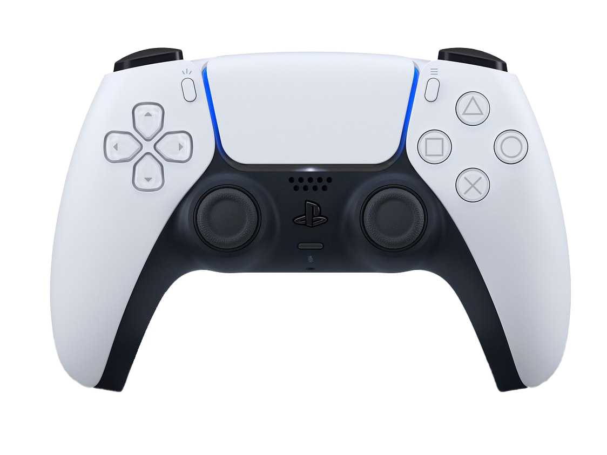
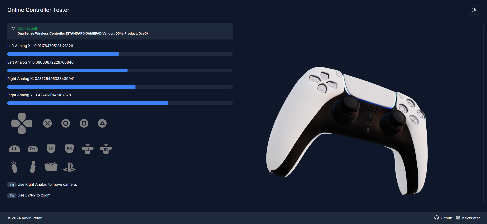

<a username="readme-top"></a>
<!-- PROJECT LOGO -->
<br />
<div align="center">
  <a href="https://github.com/KevzPeter/Online-Controller-Tester">
    
  </a>

  <h3 align="center">Online Controller Tester</h3>

  <p align="center">
    🎮 Test your Playstation DualSense or Xbox Controllers using this interactive 3D visualization!
    <br />
    <br />
    <a href="https://online-controller-tester.vercel.app/">✨ View Demo</a>
    ·
    <a href="https://github.com/KevzPeter/online-controller-tester/issues">🐛 Report Bug</a>
    ·
    <a href="https://github.com/KevzPeter/online-controller-tester/issues">💁🏽 Request Feature</a>
  </p>
</div>


<!-- DEMO -->
## Demo

<div align="center">

</div>

<!-- ENHANCEMENTS -->
## Planned Enhancements

- [x] Support for Xbox Controllers
- [x] Add 3D Xbox Controller model
- [ ] Make 3D model interactive 
    - [ ] Highlight active buttons
    - [ ] Movable analog sticks

## Development

Use Node.js 24.x and npm. With nvm, run `nvm install 24` and `nvm use 24`
(or `nvm install` and `nvm use` with nvm-sh).

```sh
npm ci
npm run dev
```

Open http://localhost:3000. Development and production builds use Webpack to
preserve the SVG component loader. The app uses Next.js 16 and React 19.

Before opening a pull request, run `npm run check`, which runs:

- `npm run lint`: ESLint with Next.js core web vitals rules.
- `npm run typecheck`: Generate Next.js declarations, then check TypeScript without JavaScript output.
- `npm run build`: Production build, including downloading the Google font.

GitHub Actions runs these checks on pushes and pull requests under Node.js 24.
Use `npm start` to serve a completed production build. Controller hardware and
browser behavior are not covered by these checks.

### Vercel deployment

Set the project's Node.js version to `24.x`; `package.json` also declares this
runtime. Vercel manages the Node 24 minor and patch version. Validate a preview
build and confirm Node 24 in its build logs before promoting to production.
Keep the last successful deployment available for rollback. If a regression
occurs, restore that deployment first, then revert the migration as a unit;
do not depend on rebuilding with Node 20.

<!-- CONTRIBUTING -->
## Contributing

If you'd like to add enhancements, please fork the repo and create a pull request. You can also open an issue with the tag "enhancement".
Don't forget to give the project a star! Thanks again!

1. Fork the Project
2. Create your Feature Branch (`git checkout -b feature/AmazingFeature`)
3. Commit your Changes (`git commit -m 'Add some AmazingFeature'`)
4. Push to the Branch (`git push origin feature/AmazingFeature`)
5. Open a Pull Request

<p align="right">(<a href="#readme-top">back to top</a>)</p>


<!-- MARKDOWN LINKS & IMAGES -->
<!-- https://www.markdownguide.org/basic-syntax/#reference-style-links -->
[contributors-shield]: https://img.shields.io/github/contributors/othneildrew/Best-README-Template.svg?style=for-the-badge
[contributors-url]: https://github.com/othneildrew/Best-README-Template/graphs/contributors
[forks-shield]: https://img.shields.io/github/forks/othneildrew/Best-README-Template.svg?style=for-the-badge
[forks-url]: https://github.com/othneildrew/Best-README-Template/network/members
[stars-shield]: https://img.shields.io/github/stars/othneildrew/Best-README-Template.svg?style=for-the-badge
[stars-url]: https://github.com/othneildrew/Best-README-Template/stargazers
[issues-shield]: https://img.shields.io/github/issues/othneildrew/Best-README-Template.svg?style=for-the-badge
[issues-url]: https://github.com/othneildrew/Best-README-Template/issues
[license-shield]: https://img.shields.io/github/license/othneildrew/Best-README-Template.svg?style=for-the-badge
[license-url]: https://github.com/othneildrew/Best-README-Template/blob/master/LICENSE.txt
[product-screenshot]: images/screenshot.png
[Next.js]: https://img.shields.io/badge/next.js-000000?style=for-the-badge&logo=nextdotjs&logoColor=white
[Next-url]: https://nextjs.org/
[React.js]: https://img.shields.io/badge/React-20232A?style=for-the-badge&logo=react&logoColor=61DAFB
[React-url]: https://reactjs.org/
[Docker]: https://img.shields.io/badge/docker-%230db7ed.svg?style=for-the-badge&logo=docker&logoColor=white
[Docker-url]: https://docker.com/
