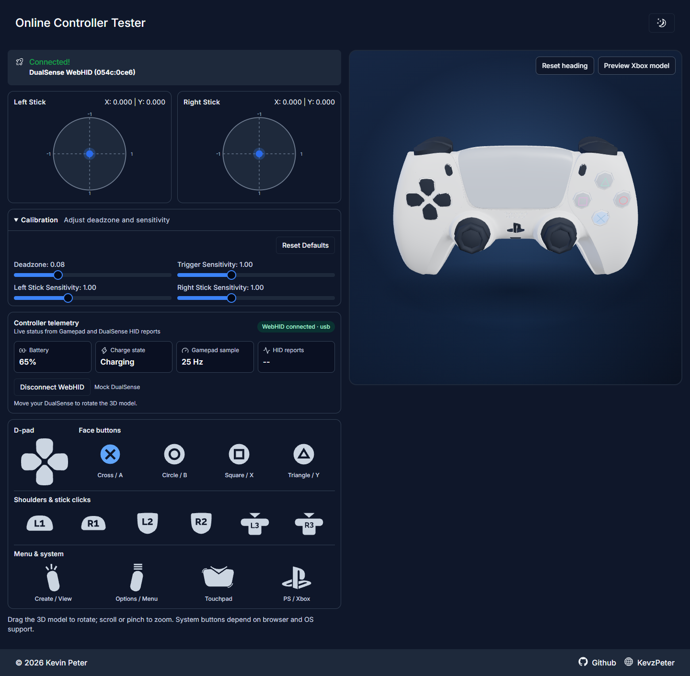


 

  

  <h3 align="center">Online Controller Tester</h3>

  

    🎮 Plug in a DualSense or Xbox controller and see what every press is doing.
     
     
    <a href="https://online-controller-tester.vercel.app/">✨ View Demo</a>
    ·
    <a href="https://github.com/KevzPeter/Online-Controller-Tester/issues/new">🐛 Report Bug</a>
    ·
    <a href="https://github.com/KevzPeter/Online-Controller-Tester/issues/new">💁🏽 Request Feature</a>
  

## Demo

  
   

## Features

- [x] Live feedback for buttons, D-pad, sticks, and triggers
- [x] Animated 3D DualSense and Xbox Elite models
- [x] Deadzone and sensitivity calibration controls
- [x] Battery, charging, and motion tracking through WebHID

The matching model loads automatically when your controller connects. Drag the model to look around, and scroll or pinch to zoom.

For more, check out the [docs](docs/README.md)

(<a href="#readme-top">back to top</a>)

