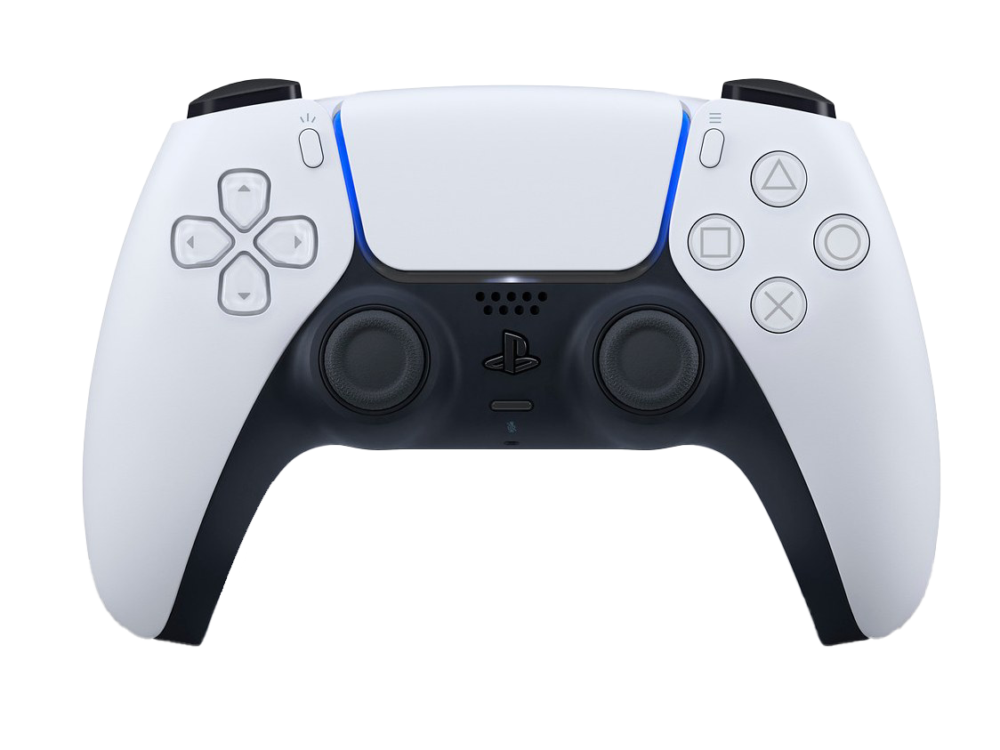
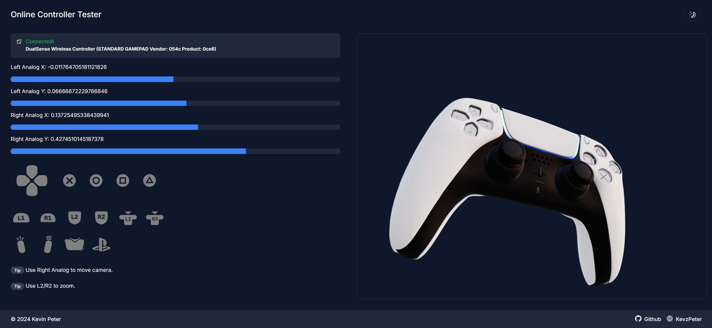

<a id="readme-top"></a>
<br />
<div align="center">
  <a href="https://github.com/KevzPeter/Online-Controller-Tester">
    
  </a>

  <h3 align="center">Online Controller Tester</h3>

  <p align="center">
    🎮 Plug in a DualSense or Xbox controller and see what every press is doing.
    <br />
    <br />
    <a href="https://online-controller-tester.vercel.app/">✨ View Demo</a>
    ·
    <a href="https://github.com/KevzPeter/Online-Controller-Tester/issues/new">🐛 Report Bug</a>
    ·
    <a href="https://github.com/KevzPeter/Online-Controller-Tester/issues/new">💁🏽 Request Feature</a>
  </p>
</div>

## Demo

<div align="center">
  
  <br />
  <sub>Screenshot from an earlier build. The tester now has animated DualSense and Xbox models.</sub>
</div>

## What's working

- [x] Live feedback for buttons, D-pad, sticks, and triggers
- [x] Animated 3D DualSense and Xbox Elite models
- [x] One D-pad that lights up every direction you press, even diagonals
- [x] Deadzone and sensitivity controls that remember your settings
- [x] A temporary model switch: use your PS5 controller on the Xbox model, or your Xbox controller on the PS5 model
- [x] Optional DualSense battery, charging, and motion tracking through WebHID

The matching model loads automatically when your controller connects. Drag the model to look around, and scroll or pinch to zoom.

## Try it locally

You'll need Node.js 24.x, npm, and a browser that supports WebGL and the Gamepad API. No controller? You can still look at both models with the preview switch.

```sh
git clone https://github.com/KevzPeter/Online-Controller-Tester.git
cd Online-Controller-Tester
npm ci
npm run dev
```

Open [http://localhost:3000](http://localhost:3000), connect a controller by USB or Bluetooth, and press a button so the browser picks it up. Try the D-pad diagonals, click both sticks, and pull the triggers partway to see their travel. Use **Reset Defaults** if you want to undo calibration changes.

## Good to know

The browser's Gamepad mapping doesn't expose every controller feature. DualSense touchpad *click* works when the browser reports button 17, but touch coordinates, adaptive-trigger resistance, and the mute button aren't available here. Xbox Elite paddles activate whichever standard button they're mapped to; the browser doesn't give them separate inputs. Your operating system may intercept the PS or Xbox button.

For battery and motion, desktop Chrome or Edge can connect to DualSense WebHID on HTTPS or localhost. See the [WebHID setup and motion guide](docs/dualsense-webhid.md) for permissions, USB/Bluetooth limitations, relative heading, and hardware checks.

## Building and contributing

Run `npm run check` before a pull request. It runs ESLint, TypeScript checks, `npm test` (HID parsing, motion, input selection, and connection lifecycle), and a production build. `npm run build` followed by `npm start` serves that build locally.

The model files can be rebuilt with `npm run model:dualsense` and `npm run model:xbox`. Their scripts check the source assets before making the animated versions. If you change input or 3D behavior, please test both controller families, disconnect/reconnect, simultaneous presses, and calibration after a reload. See [AGENTS.md](AGENTS.md) for more repository details.

If you'd like to improve the tester, fork it, make a focused branch, and open a pull request. Include what changed, how you tested it, and a screenshot or short recording for visual changes. Ideas and bug reports are welcome in [Issues](https://github.com/KevzPeter/Online-Controller-Tester/issues). And if the tester helped you, give it a star. Thanks!

## Model credit

The Xbox Elite model is based on [Xbox Elite Controller](https://sketchfab.com/3d-models/xbox-elite-controller-32aad0ff25f7446b8afe649ea3cc9e43) by [Rusfort](https://sketchfab.com/Rusfort), licensed under [CC BY 4.0](https://creativecommons.org/licenses/by/4.0/). I separated controls and added animation pivots and D-pad sectors. The [original attribution](public/xbox_elite_controller/license.txt) is included with the asset.

<p align="right">(<a href="#readme-top">back to top</a>)</p>
